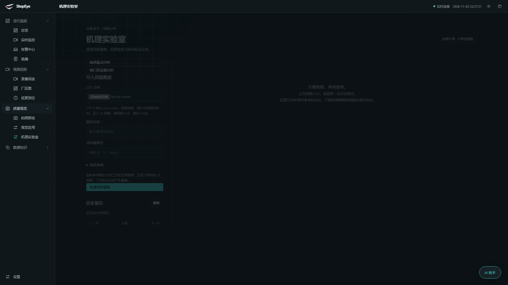
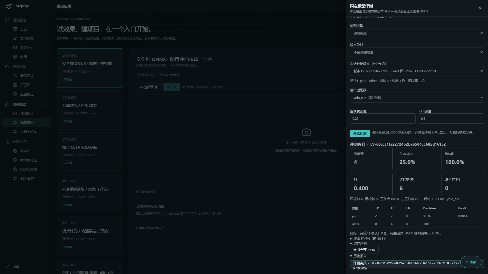
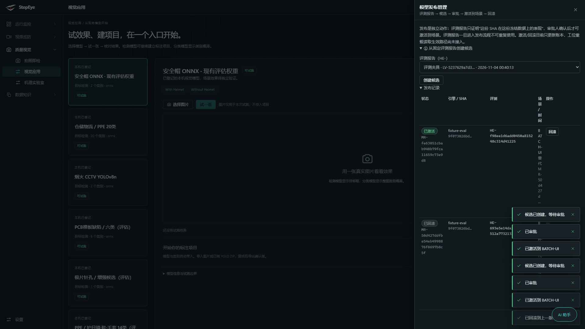
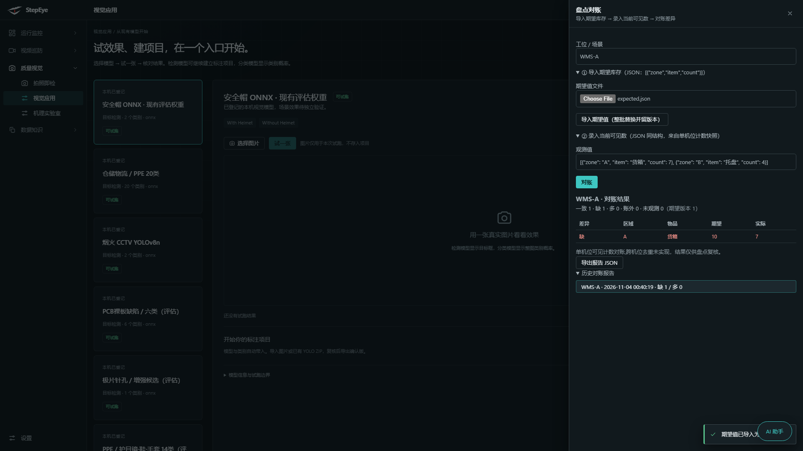
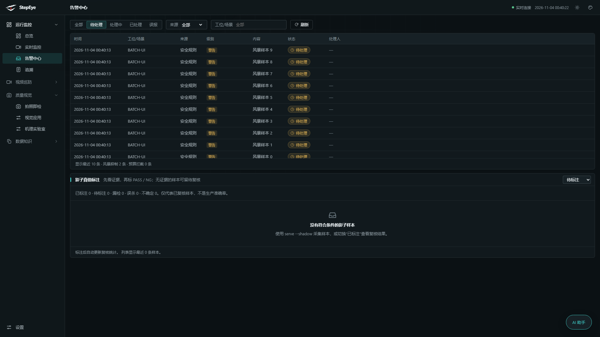

# StepEye · 工业视觉平台

纯视觉的工厂合规与质量平台：不接 PLC、不改产线，用摄像头与设备信号判断 **SOP 步骤是否做全、顺序是否正确、安全是否合规、质量是否受控**，每个工件周期生成可追溯证据。

> 诚实边界：全部能力在仿真与公开数据上验证并真实跑通；**尚未在真实产线完成现场精度验收**，评测报告与指标均如实标注数据口径，不冒充现场验收结论。

## 能力总览

| 领域 | 能力（软件侧已落地） |
|---|---|
| 实时监控 | 多工位实时画面、SOP 状态机（步骤/顺序/节拍）、WebSocket 实时推送 |
| 安全合规 | 区域入侵、烟火检测、PPE 关联、人车距离/限速、跌倒倒地、**睡岗**、温场信号、Modbus 只读信号桥 |
| 仓储盘点 | 区域计数上下限、通道占用、货箱计数、**账实核对（期望版本化 + 不可变对账报告）** |
| 质量视觉 | 拍照即检、读码/OCR、SPC/GR&R/柏拉图、尺寸测量、设备结果接入与复判、电芯六面汇总、连接器针脚 |
| 模型全生命周期 | 登记 → 试测 → 标注（确认制/组隔离）→ 冻结数据版本 → **固定 SHA 评测（逐图 FP/FN + AP@0.5/0.5:0.95）** → **发布账本（审批/激活/回滚，SHA 校验生效）** |
| 告警治理 | 风暴抑制（自动聚合）、统一冷却（可选）、规则预算、误报分析 |
| 机理实验室 | 轴承包络谱、阀门双证据影子、周期/趋势分析（复用 weihu，不可变报告） |
| 知识与文档 | SOP 文档问答（权限内检索）、动作参考卡、**文档中心**（项目文档 Markdown 在线阅读） |
| 运维 | 数据范围权限（MCP 白名单）、备份恢复 CLI、存储用量/配额、四渠道通知 |



## 快速开始

```powershell
cd sop-vision
pip install -r requirements.txt
python -m visual serve configs/demo_sim.yaml --port 8000
# 浏览器打开 http://127.0.0.1:8000（演示配置为仿真工位,无需摄像头）
```

- 默认无认证（本机工具模式）；加 `--auth` 启用用户体系（首个用户需初始化，见 `docs/USAGE.md`）。
- Windows 打包：`deploy/build_windows.bat` 产出独立 exe（服务+前端+文档内置）。

## 界面速览

| | |
|---|---|
|  |  |
| 固定 SHA 评测：逐图 FP/FN + AP | 发布管理：审批 → 激活 → 回滚 |
|  |  |
| 盘点对账：三步出差异 | 告警中心：治理计数按需显示 |

## 架构一句话

FastAPI 单服务单体 + 零构建原生 JS 前端 + SQLite 不可变证据库；模型/流媒体/采集全部可选组件、缺失自动降级。详细导览见 **[docs/TECH-ARCHITECTURE.md](docs/TECH-ARCHITECTURE.md)**，逐项任务状态见 **[docs/TASK-COVERAGE.md](docs/TASK-COVERAGE.md)**，日常使用见 **[docs/USAGE.md](docs/USAGE.md)**（也可登录后在「数据知识 → 文档中心」直接阅读）。

## 开发

```powershell
cd sop-vision
python -m pytest -q          # 全量 1200+ 用例;CI(Windows/Linux×主测试/MCP)守护
python -m visual validate configs/demo_sim.yaml   # 离线校验规则编译
```

- 前端零构建：改 `web/` 即生效；JS 语法用 `node --check` 守护。
- 发布流程的模型权重、数据集许可按模型/代码/数据分别登记（`models/public/*.json`）；评测候选不自动上线。
- 工位上线向导：文档 → 步骤草稿 → 人工确认 → YAML → 一键热加岗（无需重启）。

## 许可与状态

- 代码：见仓库内 LICENSE/各文件头；复用组件的许可边界单独登记（`docs/WEIHU-REUSE.md` 等）。
- 媒体：可选外接 [Monibuca](https://github.com/Monibuca) v6（WHEP）；平台代码不内嵌其源码。
- 当前状态与交接记录：[docs/TASK-COVERAGE.md](docs/TASK-COVERAGE.md) 与 [HANDOFF.md](HANDOFF.md)。
