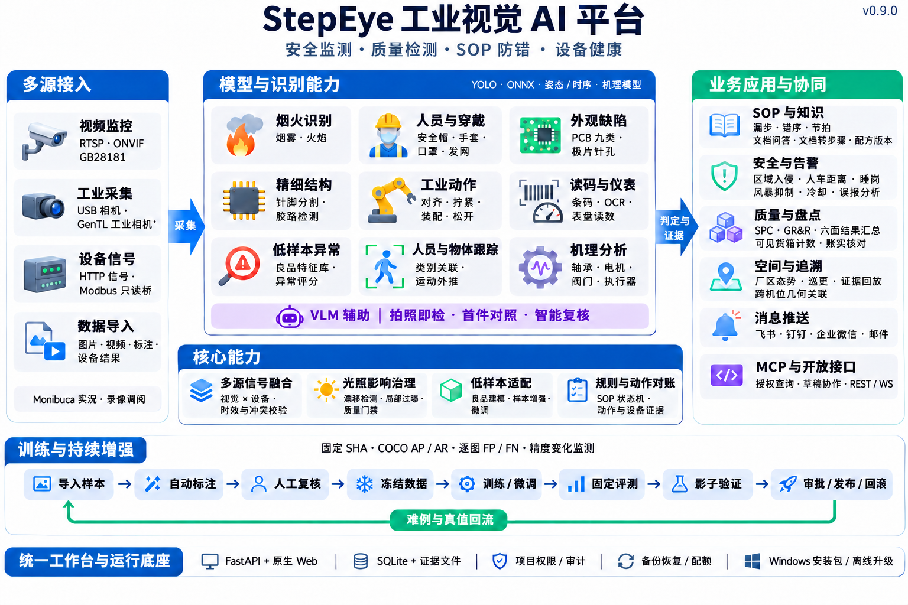
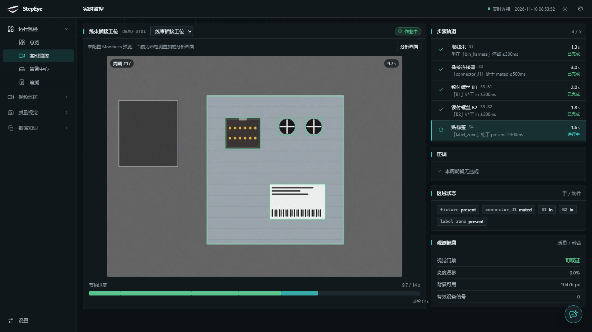
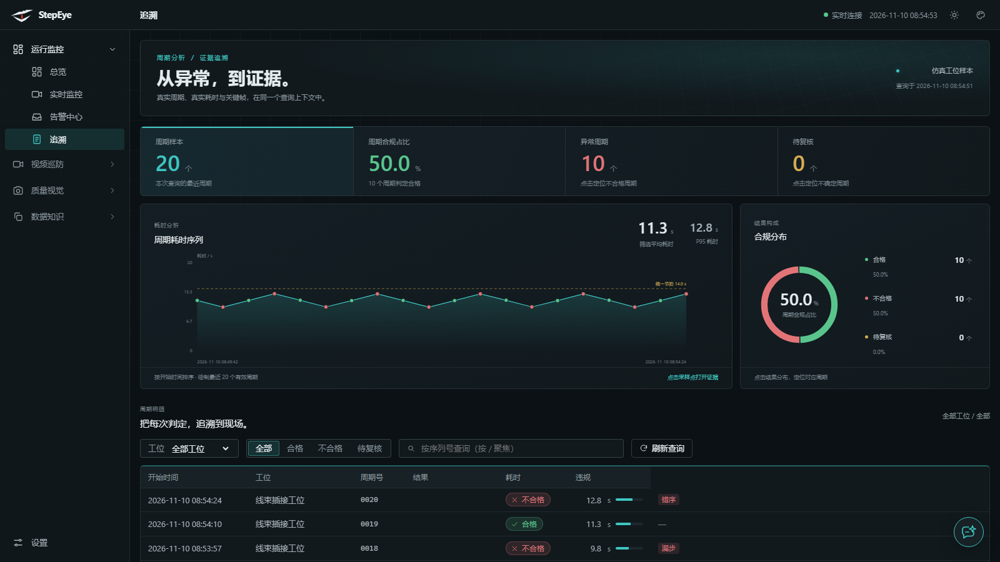
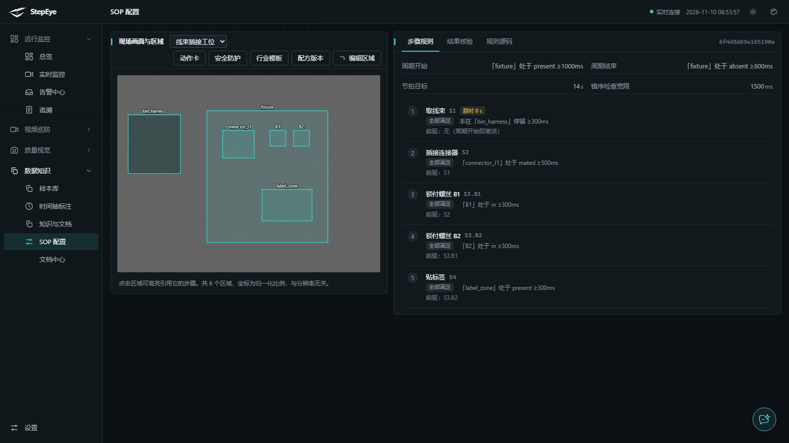
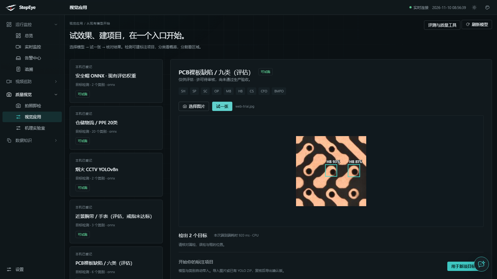
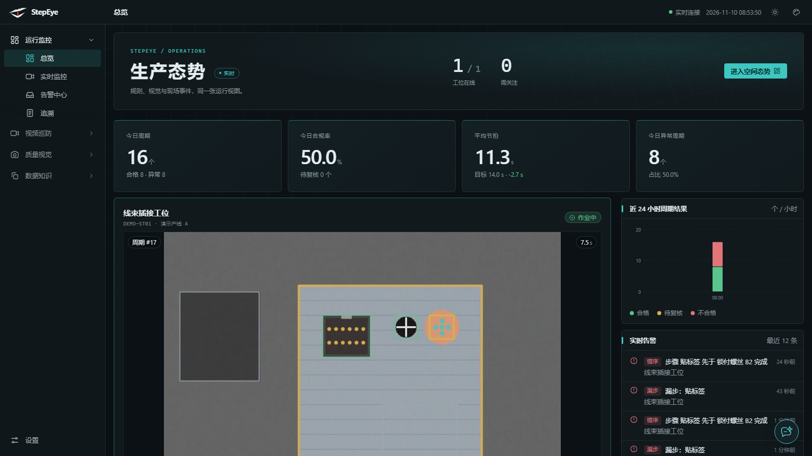

# StepEye · 工业视觉平台



一条产线上，摄像头看到的东西比报表多得多：手有没有伸到位、螺丝有没有按顺序锁、护具戴没戴、标签贴没贴、这一件为什么比上一件慢了三秒。StepEye 把这些变成可查的周期记录——一个工件一个周期，一个步骤一条证据，出了问题能倒回去看。

不接 PLC 也能跑。接了 PLC、Modbus、扭力枪或称重，设备信号会和视觉结果记在同一个周期里。

当前版本 **v0.9.0**，安装包、便携包、源码包都在 [Releases](https://github.com/fatasia/StepEye/releases/tag/v0.9.0)。



## 三种用法

| 方式 | 适合 | 入口 |
|---|---|---|
| Windows 安装包 | 装上就用，不碰命令行 | `StepEye-Setup-0.9.0.exe` |
| 便携运行包 | 不写注册表，解压即用 | `stepeye-runtime-windows.zip` |
| 源码包 | 改代码、接自己的模型 | `stepeye-source-0.9.0.zip` |

### 安装包

双击 `StepEye-Setup-0.9.0.exe`，一路下一步。装到 `%LOCALAPPDATA%\StepEye`，创建开始菜单和桌面快捷方式，不需要管理员权限。

从开始菜单打开 StepEye，会拉起演示工位，浏览器访问 <http://127.0.0.1:8000>。演示画面是仿真的，没有摄像头也能看完整流程：取线束、插连接器、锁两颗螺丝、贴标签。

要开登录和多用户：

```powershell
cd "$env:LOCALAPPDATA\StepEye"
.\stepeye-runtime.exe passwd admin --role admin --data data
.\stepeye-runtime.exe serve .\_internal\configs\demo_sim.yaml --port 8000 --auth --data data
```

覆盖安装只替换程序文件，`data\` 原地保留；卸载同样保留数据，重装后接着用。

### 便携运行包

解压到任意目录，`stepeye-runtime.exe` 就是完整服务。默认配置在 `_internal\configs\`，直接跑：

```powershell
.\stepeye-runtime.exe serve .\_internal\configs\demo_sim.yaml --port 8000 --data data
```

### 源码包

解压后双击 `START-WINDOWS.bat`（Linux/macOS 用 `START-LINUX.sh`），脚本会建虚拟环境、装依赖、启动演示工位。

手动启动：

```powershell
python -m venv .venv
.venv\Scripts\activate
pip install -r requirements.txt
python -m visual serve configs/demo_sim.yaml --port 8000
```

源码包带演示用的 MediaPipe 手部/姿态/目标检测模型；训练和评测用的大权重不在包里，来源与许可记在 `models/public/*.json`。

## 功能

### 实时监控与 SOP

- 多工位同时接入，RTSP、本地视频、USB 相机、仿真画面都走同一套配置。
- SOP 状态机：步骤、顺序、`foreach` 循环（比如两颗螺丝按 strict 顺序）、超时、宽限时间。
- 证据不只有画面：手部在区域内的停留时长、区域状态（到位/装好/贴好）、设备信号、步骤耗时，任一满足才推进。
- 循环由工件状态触发，一个周期一份记录，节拍、合格率、异常周期实时统计。
- 画质门禁：模糊、亮度、镜头位移先拦一层，画面不可信时不给结论。

### 安全与合规

- 区域入侵、人员计数、无人值守、人员聚集、通道占用。
- 烟火检测，蒸汽和反光会误报，现场按点位单独调。
- PPE 逐人关联：安全帽、工装、护目镜、手套、鞋，绑到具体的人而不是画面里有个帽子。
- 人车距离与叉车限速，基于画面标定，不依赖雷达。
- 跌倒、睡岗（区域 + 位移规则）。
- 温场信号、热失控分级。
- Modbus 只读桥：PLC 寄存器变化转成平台信号，反向不写。

### 质量与检测

- 拍照即检：上传或触发拍照，VLM 按场景模板判定 PASS / NG / UNCERTAIN，附理由；支持单图与首件两种模式。
- 读码与 OCR：条码/二维码用 zxing-cpp，字符用 RapidOCR，都是本地 CPU。
- 固定模型检测：YOLO 系列、RT-DETR、整图分类、区域分割，统一在视觉应用里试跑。
- 尺寸测量与相机标定，表盘读数。
- 连接器针脚：掩膜分割 + 针高/弯针判断。
- 电芯六面检测汇总，焊缝外观 OK/KO。
- 设备结果复判：把扭力、称重、测试机的判定拉进来和视觉结果对齐。
- SPC：I-MR 控制图、过程能力、缺陷柏拉图、GR&R。

### 模型全生命周期

- 试推：选模型、传图、看框和耗时，端到端计时（含解码与后处理）。
- 标注：样本库、时间轴标注、YOLO ZIP 导入，人工确认后才进数据集。
- 冻结数据集：按来源组隔离，算 SHA 指纹，冻结后不可改。
- 固定 SHA 评测：逐图 FP/FN 报告，COCO 12 项 AP/AR，报告不可变、可导出。
- 发布：评测报告 → 候选 → admin 审批 → 激活到工位 → 需要时回滚。模型文件带签名，SHA 对不上拒绝生效。
- 精度监测：激活后的模型按批次持续比对，退化到阈值会提示。
- 动作对账：VideoMAE 影子结果和步骤期望动作逐周期比对，可带最近 30 秒设备信号作证据。

### 数据与证据

- 周期追溯：节拍趋势、合格分布、逐周期明细，可按工位、结果、序列号查。
- 录像回放：Monibuca 录像索引，按时间检索，浏览器直接播。
- 盘点对账：导入期望库存 → 录入可见计数 → 出差异表（缺/多/账外/未观测），报告不可变。
- 知识与文档：SOP 文档上传、版本管理、文档问答，步骤草稿可从文档生成再人工确认。
- 操作日志：谁在什么时候调了哪个写接口，记账号、路由、状态，不记请求正文。

### 平台与运维

- 三级角色：viewer 只读、operator 操作、admin 管理；浏览器数据范围可按项目过滤。
- 存储配额与磁盘水位，超限前提示；操作日志记录业务写请求的账号、路由和状态。
- 通知渠道：邮件、飞书、企业微信、钉钉（Apprise），渠道和模板在设置里配。
- 告警治理：风暴抑制、同键冷却、规则预算、误报分析；计数落盘，重启不归零，冷却时间可在告警页直接改。
- 离线升级：清单 + SHA256 校验 + 安全解压 + 原子切换 + 失败回滚。
- MCP 接口：外部 Agent 只读查询项目、标注和质量报告，也能提交标注建议，令牌按项目授权。

## 模型

视觉应用里登记了 **18 个可试跑模型**，覆盖检测、分类、分割三类任务，全部本地 ONNX 推理，CPU 可跑。另有动作识别和机理诊断模型在后台链路里。

### 检测与分类

| 用途 | 模型 | 规格 | 状态 |
|---|---|---|---|
| 仓储 / PPE | 仓储物流 20 类 | YOLO · 12MB | 可试跑 |
| 安全 | 安全帽 2 类 | YOLO · 12MB | 可试跑 |
| 安全 | PPE 护目镜/鞋/手套 14 类 | YOLO · 43MB | 可试跑 |
| 安全 | 烟火 2 类（4 个来源版本） | YOLOv8n/s · 12–43MB | 可试跑 |
| 安全 | 近景腕带 / 手表 3 类 | YOLO · 12MB | 可试跑，戒指未达标 |
| 质量 | PCB 裸板缺陷 6 类 / 9 类 | YOLO · 12–36MB | 可试跑 |
| 质量 | 极片针孔 1 类 | YOLO · 12MB | 可试跑 |
| 质量 | 焊缝外观 3 类 | YOLOv8 · 43MB | 可试跑 |
| 质量 | 电池焊缝 OK/KO（v1/v2） | 分类 · 0.3MB | 可试跑 |
| 质量 | 胶路断胶 / 过量胶 2 类 | YOLOv4-Tiny · 22MB | 可试跑 |
| 质量 | PCB 针脚分割 | U-Net ResNet34 · 158MB | 可试跑 |
| 环境 | 地面积水 1 类 | RT-DETR INT8 · 20MB | 可试跑 |
| 环境 | 地面干湿二分类 | ConvNeXt-Tiny INT8 · 33MB | 可试跑 |

### 动作与机理

| 用途 | 模型 | 说明 |
|---|---|---|
| 工业动作识别 | VideoMAEv2-Small + 4 类线性头 | 对齐物料 / 拧紧螺母 / 装螺母 / 松螺母；影子模式逐周期对账 |
| 轴承诊断 | 包络谱 + 谐波证据 | 内圈/外圈/滚动体/保持架，输出证据而非单一分数 |
| 电机故障 | 随机森林 + 特征提取 | 10 类轴承与断条故障 |
| 执行器 | ONNX 集成 | 正常 / 背隙 / 缺润滑 / 剥落 |
| 阀门 | 冻结 ONNX 融合 | 双证据（信号 + 动作），缺证据输出 unsupported |
| 剩余寿命 | C-MAPSS、FEMTO 退化相似性 | 趋势级 RUL，不替代厂家寿命模型 |

### 基础感知

MediaPipe 手部 21 点、姿态、EfficientDet-Lite0 目标检测，用于手部停留判定和人员定位，随包附带。

模型的许可、来源、SHA 逐项登记在 `models/public/*.json`。多数权重来自公开数据集训练，评估可用，商用再分发前需要按登记表逐项确认。

## 界面

| | |
|---|---|
|  |  |
| 追溯：节拍趋势、合格分布、逐周期明细 | SOP 配置：区域画在图上，步骤和证据在右边 |
|  |  |
| 视觉应用：18 个模型试推，2 个缺陷 920ms | 总览：工位状态、节拍、今日异常 |

## 架构

开头那张图是整体分层：多源接入 → 模型与识别 → 业务应用，下面接训练链路和运行底座。落到代码目录是这样：

FastAPI 单服务 + 零构建原生 JS 前端 + SQLite 证据库。模型、流媒体、采集都是可选组件，缺了就降级，不影响主流程。

```
visual/      规则引擎、感知、安全、质量、模型治理、路由
web/         原生 JS 页面与样式，改完刷新即生效
configs/     工位 YAML 与模板
deploy/      打包、安装、升级、Monibuca
tools/       训练、导出、评测、巡检脚本
tests/       pytest 全量用例
models/      模型权重与登记表
docs/        技术、使用与模型文档
```

仓库根就是服务本体，这些目录之外只剩 README、依赖清单和 CI 配置。

一条周期从采集线程进来，依次过画质门禁、手部/人员感知、区域状态核验、SOP 状态机、安全规则、告警治理，最后落到证据库。试推和标注推理跑在独立子进程里，用完退出；在线检测器常驻服务进程。

更细的导览见 [TECH-ARCHITECTURE](docs/TECH-ARCHITECTURE.md)。

## 开发

```powershell
python -m pytest -q                              # 全量 1501 passed / 2 skipped
python -m visual validate configs/demo_sim.yaml  # 校验规则编译
node --check web/js/main.js                      # 前端零构建，语法单独检查
```

- 前端不用打包器，`web/` 改完刷新即可。
- 模型、代码、数据许可分开登记在 `models/public/*.json`。
- 工位上线：文档 → 步骤草稿 → 人工确认 → YAML → 热加岗。

## 文档

- [使用说明](docs/USAGE.md)：装、配、用、排查
- [技术架构](docs/TECH-ARCHITECTURE.md)
- [全部文档](docs/README.md)：能力、模型、接入、运维

## 范围

代码和模型在仿真、公开数据和固定 holdout 上验证过；现场精度要按实际工位验收，同一套模型换一条线、换一个光照，结果会不一样。

运行包内含评估模型与 Monibuca v6 beta，商用再分发前按 `models/public/*.json` 里的许可登记逐项确认。
