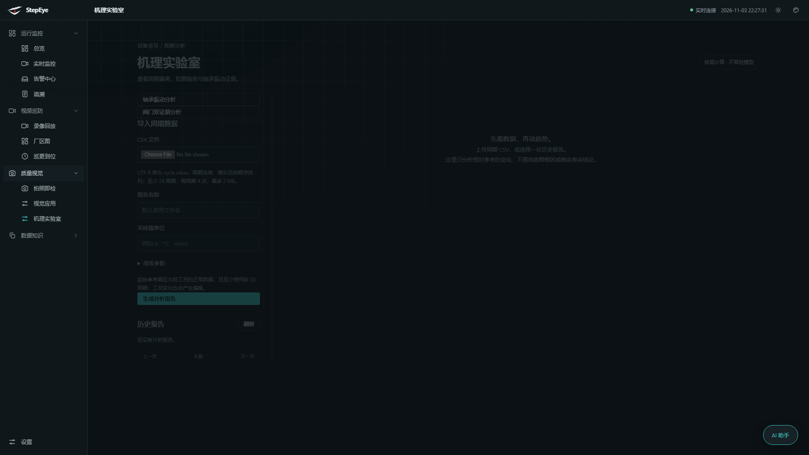
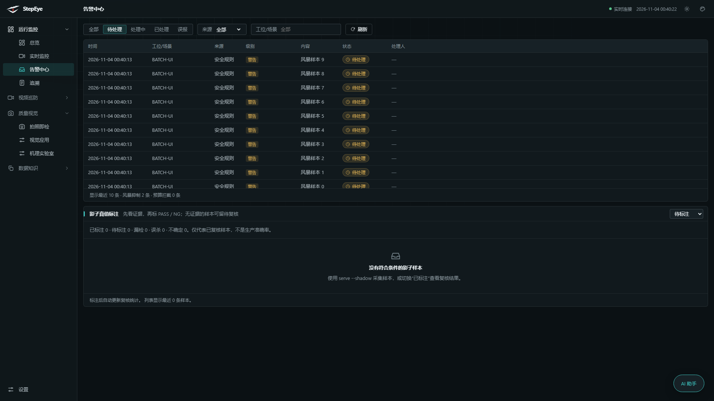
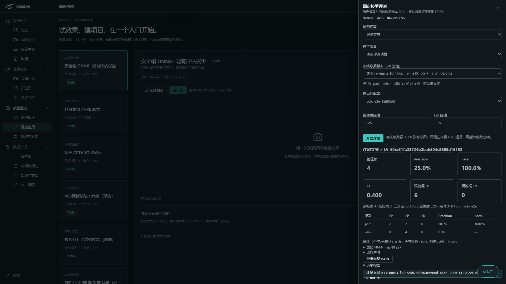
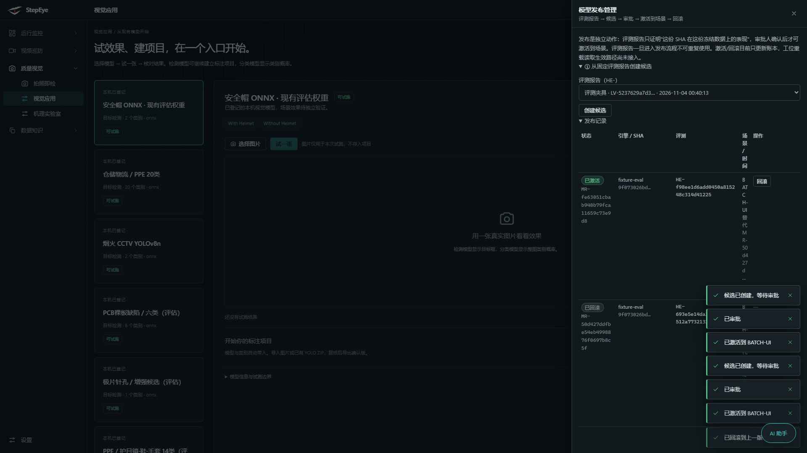
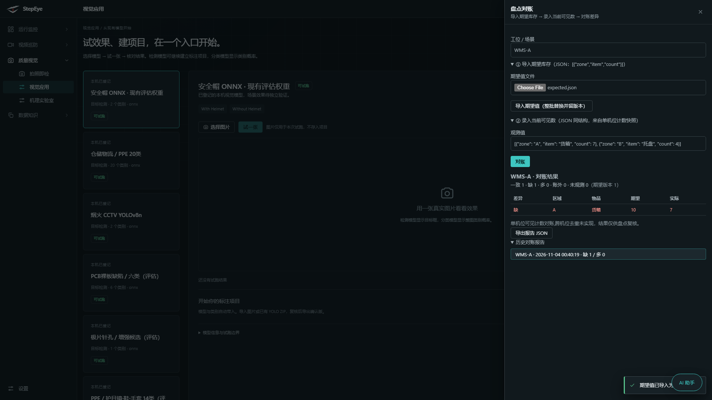

# StepEye 使用指南

面向工厂管理员与操作员的日常使用说明。所有截图来自真实界面（1920×1080，暗色主题）。

## 1. 登录与角色

浏览器打开服务地址即进入登录页。平台有三级角色：

| 角色 | 权限 |
|---|---|
| viewer | 只读：看监控、告警、报告、文档 |
| operator | 操作：处理告警、标注、导入盘点期望值、发起评测 |
| admin | 管理：用户管理、模型发布审批/激活/回滚、AI 服务配置、存储配额 |

左侧导航按任务分组，当前页面所在分组自动展开，记忆折叠状态。

## 2. 实时监控与告警

- **总览 / 实时监控**：各工位实时画面、周期状态、SOP 步骤进度。分析画面默认叠加检测框与区域。
- **告警中心**：待处理告警逐条处置（处理中 / 已处理 / 误报），底部影子真值标注区用于人工复核系统判定。
- 告警治理自动运行：同源告警爆发时自动聚合成一条「风暴摘要」，超预算的触发如实计入页脚统计，不需要人工干预。页脚计数只在有值时出现。

## 3. 模型试用与标注训练

- **视觉应用**：选择本机已登记模型 → 上传一张图试效果 → 一键创建同类别标注项目。
- **样本库 / 标注工作台**：导入图片或 YOLO ZIP，人工确认后导出冻结数据集版本（组隔离、SHA 指纹）。
- **固定模型评测**（视觉应用 → 评测与质量工具）：绑定已登记模型 × 冻结数据版本，逐图 FP/FN 报告，含 AP@0.5 与 AP@0.5:0.95。评测在本机 CPU 运行，报告不可变、可导出。

## 4. 模型发布

评测通过 ≠ 上线。发布走独立审批：

1. 在「评测与质量工具 → 发布管理」从评测报告创建候选；
2. admin 审批；
3. 激活到目标场景（工位重载后检测器即切换为审批过的模型文件，SHA 校验失败则拒绝生效）；
4. 需要时一键回滚到上一个已激活版本。

## 5. 盘点对账

「评测与质量工具 → 盘点对账」三步：

1. 导入期望库存 JSON（`[{"zone","item","count"}]`，整批替换并留版本）；
2. 录入当前可见计数（来自单机位计数快照）；
3. 对账看差异表（缺 / 多 / 账外 / 未观测），报告不可变、可导出、留历史。

注意：这是单机位可见计数对账，跨机位去重未实现，结果仅供盘点复核。

## 6. 机理实验室

轴承振动分析（包络谱、谐波证据）、阀门双证据分析（冻结 ONNX 融合模型 + 影子报告）。所有报告不可变，支持历史查询与 JSON 导出。缺证据时输出 unsupported，不臆测分数。

## 7. 文档中心

左侧「数据知识 → 文档中心」进入：项目全部技术与使用文档（本页就在文档中心里），支持 Markdown 渲染与配图，viewer 角色即可阅读。

## 8. 常见问题

- **告警太多看不过来？** 治理自动运行；也可设置 `STEPEYE_ALERT_COOLDOWN_S` 环境变量开启同键冷却（秒）。
- **模型换了想回退？** 发布管理里回滚，工位重载即恢复上一审批版本。
- **评测报告可以对外发布吗？** 报告 scope 如实标注「导出 val 上的验证，非独立未见数据」；不能当作现场验收结论。
