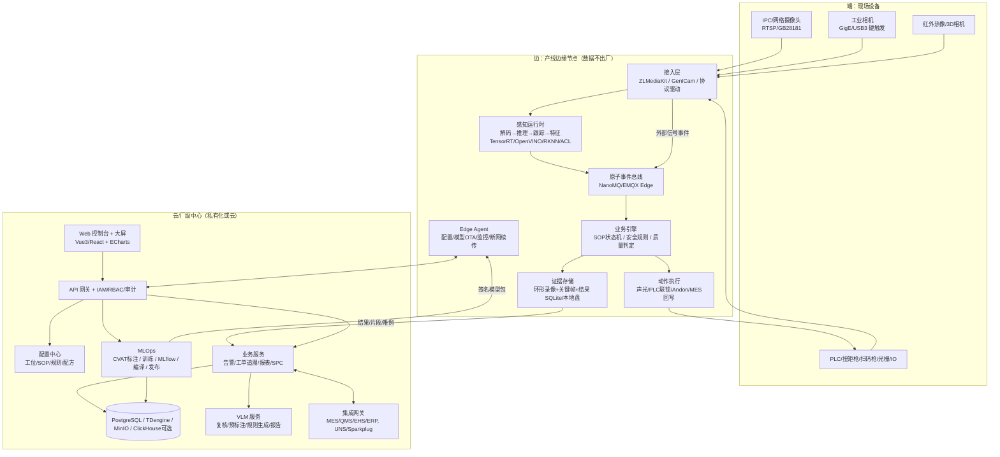
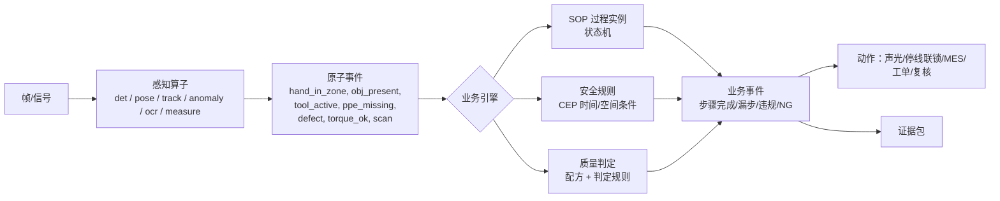
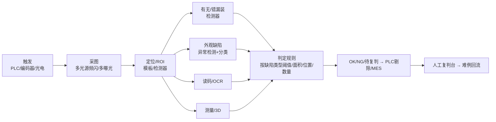
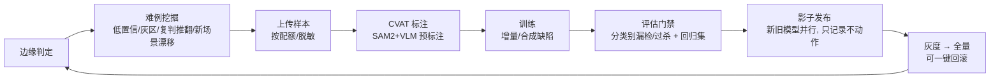

# 工业视觉 AI 平台技术方案（安全 · 质量 · SOP）

> 适用行业：通用离散装配产线 / 锂电制造 / 汽车电子制造  
> 版本：v1.0（2026-11）  
> 参考：[gitee.com/volara/AI-SOP](https://gitee.com/volara/AI-SOP)，以及 2024–2026 公开技术与市场资料（见文末来源）

---

## 0. 结论先行

1. **定位**：做一个“**统一感知底座 + 三类业务引擎（安全 / 质量 / SOP）+ 工业集成与追溯**”的云边端平台，不和相机厂、AOI 设备厂、线扫装备厂拼硬件，而是**做跨品牌的 AI 层**。
2. **最大的市场空白在 SOP 动作合规**。国外有 Retrocausal、Invisible AI、PowerArena，国内缺少专业玩家（海康才开始做）。头部电池厂、车企主要自研质检，中腰部工厂主要外采。所以切入顺序建议是 **SOP 防错 → 安全 EHS → 质量 AI 复判 / 工位质检**。
3. **技术核心不是某个模型，而是“事件 + 规则 + 状态机”**。感知层把视频变成原子事件，包括手进区域、取件、工具作业、PPE 缺失和缺陷；业务层再用可配置 DSL 判定 SOP、安全违规和质量结果。参考项目用时间窗 + LSTM 判断步骤，**节拍一变就会失效，也不能多工单并发**，必须升级成**“视觉证据 + 外部信号（扭矩枪 / 扫码 / PLC IO）融合的工序状态机”**。
4. **热路径用小模型，冷路径用大模型**。实时推理使用 YOLO 类、RT-DETR、RTMPose 和 EfficientAD/PatchCore；VLM（Qwen3-VL / InternVL）只做复核、自动标注、规则生成和报告，**不进入毫秒级判定链路**。
5. **必须先确认两个红线**：
   - **Ultralytics YOLOv8/YOLO11 采用 AGPL-3.0**，闭源商用需要购买企业授权，或改用 Apache-2.0 模型（RT-DETR / D-FINE / DEIM / RTMDet / YOLOX）。见 ADR-03。
   - **视觉安全不属于功能安全器件**，不能替代 ISO 13849 / IEC 61496 安全光栅和门锁，只能做辅助告警和管理闭环。
6. **验收要产品化**：按缺陷或违规类别分别约定 **漏检率 + 过杀 / 误报率**，并通过**影子模式**做验收。行业里常见的“准确率≥99%”是合同纠纷的主要来源。

---

## 1. 参考项目 AI-SOP 拆解

### 1.1 它做了什么

```text
视频 ─┬─> YOLOv8s 检测部件（base/frame/mirror/screw）
      └─> MediaPipe Hands（2手×21点）
            └─> 帧级特征拼接 → 多尺度窗口(48/72/96帧)重采样 → LSTM 分类 S1~S5
                  └─> 顺序约束 + 连续命中帧确认 → PyQt5 GUI / 截图 / 日志
```

仓库实际内容是：`ai_sop_gui.pyc`（**只有编译产物，没有 GUI 源码**）、YOLO 权重（22MB）、LSTM 权重（1.1MB）和一段演示视频。README 里提到的 `train_yolo_mirror.py`、`yolo/` 数据集**并不在仓库中**。商业版截图多是**概念 UI**，包括边缘总览、SOP 配置、追溯和报表。

### 1.2 可借鉴点

| 点 | 价值 |
|---|---|
| 物体检测 + 手部关键点融合做步骤识别 | 不依赖昂贵视频大模型，小样本可训，边缘可跑 |
| 多尺度时间窗投票 + 连续命中帧确认 | 抑制抖动的简单有效手段 |
| 顺序约束 | 把“识别”转成“合规判定” |
| 商业 UI 信息架构：工位总览 / 实时监控 / 漏步告警 / 节拍报表 / 质量追溯 / SOP 配置 | 可作为产品原型参考 |

### 1.3 落地到产线的差距（本方案要补齐的）

| 差距 | 后果 | 本方案做法 |
|---|---|---|
| 步骤用**固定时间窗**定义（配置界面里 S1=0–30s…） | 节拍波动、停线、返工时全部错位 | 事件驱动状态机，步骤由**证据**触发，时间只用来判断超时 |
| 单一 LSTM 端到端分类 | 换产品就要重新标注训练，不可解释 | 分级识别：L1 规则（区域 / 手物交互，无需训练）→ L2 学习型时序分割 → L3 VLM 复核 |
| 只用视觉 | 拧紧是否合格、是否到位，视觉判断不了 | 融合扭矩枪 OK/NG、扫码、光电 / PLC IO、拾取指示（pick-to-light） |
| 无工单 / SN 绑定 | 无法追溯，无法回写 MES | 每个过程实例绑定 SN / 工单，输出证据包 |
| 单路、单机 GUI | 无法规模化管理 | 云边端 + 多工位 / 多产线 / 多工厂 |
| 无数据闭环 | 误报不收敛 | 误报复核 → 难例挖掘 → 再训练 → 影子发布 |
| 许可证风险（YOLOv8 AGPL） | 闭源商用存在法律风险 | ADR-03 |

---

## 2. 场景需求矩阵

### 2.1 三域 × 三行业

| | 视觉安全 EHS | 视觉质量 | SOP / 作业合规 |
|---|---|---|---|
| **通用离散产线** | PPE（安全帽、反光衣、手套、护目镜）、区域入侵、人车 / 叉车接近、跌倒、烟火、玩手机 / 睡岗、通道占用 | 外观缺陷、错漏装（零件有无 / 极性 / 颜色）、OCR / 读码、尺寸测量、包装检查 | 工序漏步 / 错序、螺丝数量与顺序、工具使用、节拍 / Takt 拆解、返工工位、物料拣选防错 |
| **锂电** | 化成 / 分容 / 老化 / 仓储**热失控早期预警**（红外 + 烟雾 + 气体融合）、电解液 / NMP 泄漏、**干燥房洁净服与风淋行为**、**金属异物管控**（人员携带金属物品）、高压测试区入侵、AGV / 叉车 | 涂布（漏涂 / 划痕 / 气泡 / 颗粒 / 露箔）、分切模切毛刺、卷绕叠片 Overhang（X-ray/CT）、极耳翻折、顶盖 / 密封钉焊接、电芯六面外观、蓝膜气泡、PACK 涂胶断胶、Busbar 焊缝 | PACK 人工工位：线束插接、螺栓拧紧顺序（与拧紧枪绑定）、扫码绑定、绝缘检测、上料方向、返修工位 |
| **汽车电子** | **ESD 合规**（腕带 / 防静电服 / 鞋，EPA 区进入）、三防漆 / 助焊剂化学品操作、机器人单元入侵、叉车 | **AOI / AXI AI 复判**（降低误报）、三防漆 UV 覆盖、点胶灌胶、Press-fit 插针、连接器歪针 / 退针、外壳锁付、标签 / 激光码、屏幕 Mura、摄像头模组 | 插件（THT）、线束插接“到位”、螺丝锁付顺序、涂胶、贴标、包装；满足 IATF 16949 追溯和 Control Plan |

### 2.2 锂电关键工序指标（选型依据）

| 工序 | 典型指标（公开资料，供方案参考） | 平台角色 |
|---|---|---|
| 涂布 / 极片 | 线速 40–150 m/min，8K–16K 线扫，行频 100–200 kHz，最小缺陷约 0.1–0.2 mm，剔除响应约 20 ms | **不自研装备**：对接凌云光、海康、思谋等装备数据，做缺陷聚合、SPC、AI 复判和跨工序追溯 |
| 卷绕 / 叠片 X-ray/CT | Overhang 精度约 0.03 mm，在线 CT 2–3.5 s/颗，GRR ≤10% | 接入判定结果和图像，做 AI 二次判定和趋势分析 |
| 极耳 / 焊接 | 检出 >99.9%；焊接误判 <0.3%，漏判 0（厂商口径） | 工位级 AI 检测 + OCT 等信号融合 |
| 电芯外观 | 2.5D/3D 成像，关键缺陷零漏检 | **平台可直接做**（工位相机 + 异常检测 + 分类） |
| PACK 涂胶 / Busbar | 精度 0.07–0.1 mm，3D 线激光 | 3D 点云检测 + 规则判定 |
| 头部水平 | 宁德时代：单线约 7000 个质控点，缺陷率进入 **PPB 级** | 说明头部客户以自研为主，第三方机会在**中腰部电池厂、PACK 厂和储能厂** |

**锂电安全新法规**：GB 38031-2025（2026-07-01 实施）要求热失控后 **2 小时不起火、不爆炸**，会推动厂内热失控监测需求。

### 2.3 汽车电子关键诉求

| 方向 | 要点 |
|---|---|
| AOI 误报 | 传统 AOI 误报高，需要人工复判；Koh Young Smart Review 宣称减少约 60% 人工复判，西门子 Opcenter AOI-FCR、Mycronic 提供**跨品牌复判插件**。这是平台“质量”线最容易形成标准化产品的切入点 |
| 质量体系 | IATF 16949 / VDA 6.3、AIAG-VDA PFMEA、Control Plan、**MSA/GR&R（视觉系统也要做）**、PPAP、IPC-A-610 Class 3 |
| 追溯 | SN / 批次 / 工艺参数 / 检测图像 / 模型版本，长期保存（车规通常 ≥15 年，需按客户要求确认） |
| 信息安全 | TISAX、ISO/SAE 21434：数据不出厂、访问审计、加密存证 |
| SOP | 视觉防错与扭矩 / IO 防错**互补**：视觉管“动作 / 顺序 / 外观”，扭矩和 IO 管“力值 / 到位” |

---

## 3. 市场与竞争格局（摘要）

| 赛道 | 代表厂商 | 格局判断 |
|---|---|---|
| 机器视觉硬件 + 算法 | Cognex、Keyence、Basler、Zebra(Matrox)、MVTec；海康机器人、华睿、凌云光、奥普特、天准 | 中国 2D 相机出货约 70% 由海康机器人和华睿占据；硬件红海 |
| AI 质检平台 | 思谋 SMore ViMo、创新奇智、阿丘 AQrose、华为盘古 / 昇腾、百度开物 / PaddleX、Landing AI、Siemens Inspekto、Elementary、Instrumental | 竞争激烈，头部电池厂和车企自研；**AWS Lookout for Vision 已于 2025-10 下线** |
| EHS 视频 AI | 海康、大华、极视角（算法商城）、各类边缘盒厂商 | 产品同质化、价格低（单路数百元），**痛点是误报导致告警疲劳** |
| SOP / 作业合规 | Retrocausal、Invisible AI、PowerArena、Arkite、LightGuide、Tulip、Augmentir；国内仅零星项目型厂商，海康近期推出 SOP 训推一体机（待核实） | **最明显的空白** |

**项目经济性（公开口径，差异很大，仅作量级参考）**：

| 维度 | 中国 |
|---|---|
| 边缘 AI 盒 | ¥1.2k–8 万 |
| EHS 算法 | ¥90–2000+/路 |
| 单工位质检 | ¥0.8–18 万/套 |
| 标准整线项目 | ¥15–40 万；大型项目 ¥250–620 万 |
| 部署周期 | 8–18 周 |
| 回本 | 6–18 个月 |
| 失败率 | 行业文章称 AI 视觉项目 60–70% 难以规模化 |

**常见失败原因**：

- PoC 用的是精选样本，没有覆盖真实长尾。
- 没有反馈闭环。
- MES / PLC 集成工作量被低估，可能占预算一半以上。
- 运维责任不清。
- EHS 告警疲劳。

**差异化机会**：

1. **安全 + 质量 + SOP 一体化**：同一套边缘盒、同一个平台和同一份追溯证据。
2. **换线成本从“周”降到“天”**：L1 规则 SOP 不需要训练，异常检测只需良品样本，开放词汇检测可冷启动，扩散模型可合成缺陷。
3. **告警可信度治理**：多帧确认、多源融合、抑制 / 升级策略，以及误报回流再训练。
4. **验收 SLA 产品化**：分类别指标、影子模式和自动生成验收报告。
5. **中腰部客户与 PACK / 储能 / Tier2 电子厂**：按工位或按路订阅，低代码配置。

---

## 4. 技术栈调研与选型

### 4.1 算法 / 模型

| 任务 | 生产首选 | 备选 / 增强 | 说明 |
|---|---|---|---|
| 通用目标检测 | **RT-DETR(v2) / D-FINE / DEIM**（Apache-2.0） | YOLO11 / YOLOv8（AGPL，需要商业授权）、RTMDet、YOLOX | 商用闭源优先选许可证友好的模型；YOLO 的生态和速度最优，可以买授权后使用 |
| 开放词汇 / 冷启动 | **YOLO-World**、Grounding DINO | Florence-2 | 用文本提示快速出基线，再蒸馏成专用小模型 |
| 分割 / 自动标注 | **SAM2**（视频跟踪分割） | Mask2Former | 主要用于标注加速和缺陷轮廓提取 |
| 跟踪 | **ByteTrack**（固定机位） | BoT-SORT（运动 / 拥挤场景，带 ReID） | 入侵、接近、人员轨迹 |
| 人体 / 手部姿态 | **RTMPose / RTMW**（全身 + 手） | MediaPipe Hands、YOLO-Pose | 工位手部动作、跌倒、睡岗 |
| 骨架动作识别 | **ST-GCN++ / PoseC3D** | — | 跌倒、攀爬、违规动作 |
| 工序时序分割 | **MS-TCN++ / ASFormer / DiffAct**（在特征序列上） | ActionFormer（时序动作检测） | SOP L2；输入为手物交互特征和视频特征 |
| 视频特征 | **VideoMAE v2 / InternVideo2**（离线 / 服务器） | — | 复杂长工序；不建议放在端侧实时运行 |
| 异常检测（只需良品） | **EfficientAD**（高节拍）、**PatchCore**（稳健） | Dinomaly、UniAD（多品类统一）、SimpleNet；库：**anomalib** | Real-IAD 等多视角基准上 Dinomaly 更鲁棒 |
| 缺陷分类 / 检测 | 检测器 + 分类头；小目标用切图（SAHI） | — | 用于需要区分缺陷类别的场景 |
| 缺陷合成 | 扩散模型局部重绘（Blended Latent Diffusion 等）、Copy-Paste | — | 解决缺陷样本少的问题 |
| OCR / 读码 | **PP-OCRv4/v5**（Apache-2.0）、libdmtx / ZXing-cpp | 商用读码库（Cognex/MVTec） | 激光码、DataMatrix、标签核对 |
| 3D | Open3D / PCL 点云处理 + 规则判定 | 3D 相机 SDK | 涂胶高度 / 宽度、焊缝、平面度 |
| VLM | **Qwen2.5-VL / Qwen3-VL**、InternVL | — | **冷路径**：告警复核、标注预打标、SOP 文本生成规则草稿、报告；本地私有化部署 |

### 4.2 推理与边缘

| 层 | 选型 | 取舍 |
|---|---|---|
| 统一模型格式 | **ONNX** 作为中间表示 | 一次训练，多后端编译 |
| NVIDIA | Jetson Orin NX / AGX Orin、x86 + RTX / L4；**TensorRT**；多路视频用 **DeepStream** 或自研 GStreamer pipeline | 生态最成熟；存在供应链和成本风险 |
| 国产化 | **华为昇腾 Atlas 200I/300I + CANN / ACL / MindX** | 适合信创和国企；工具链和算子覆盖需要预研 |
| 低成本 | **RK3588 + RKNN**（6 TOPS），可选 Hailo-8 | 适合 1–4 路轻量 EHS / SOP 工位 |
| Intel | **OpenVINO**（CPU / iGPU / NPU） | 适合无独显工控机的质检工位 |
| 视频接入 | **ZLMediaKit**（RTSP / GB28181 / ONVIF / RTMP，录像切片） | 支持国标、高并发和协议转换 |
| 解码 | 硬件解码：NVDEC / RK MPP / 昇腾 DVPP；FFmpeg 兜底 | 解码通常是多路场景的首要瓶颈 |
| 工业相机 | **GenICam / GigE Vision** 统一抽象（Aravis 开源；海康 MVS、Basler pylon、大恒 Galaxy SDK 适配） | 质检工位需要硬触发、频闪和曝光控制 |

### 4.3 MLOps

| 环节 | 选型 |
|---|---|
| 标注 | **CVAT**（视频 / 跟踪 / SAM2 / 3D）+ X-AnyLabeling（轻量 POC） |
| 训练 | PyTorch；检测和姿态用 OpenMMLab（MMDet / MMPose / MMAction2，Apache-2.0）或 PaddleDetection / PaddleX（国产硬件友好）；异常检测用 anomalib |
| 实验 / 注册 | **MLflow**（实验、模型注册、阶段流转） |
| 数据版本 | DVC 或 lakeFS + MinIO |
| 编排 | Argo Workflows / Airflow（训练 → 评估 → 多后端编译 → 签名 → 发布） |
| 边缘发布 | 小规模：Docker + 自研 Edge Agent；大规模：**K3s / KubeEdge**，支持灰度、回滚和断网自治 |
| 监控 | Prometheus + Grafana；模型侧监控置信度分布漂移、误报率和复核一致率 |

### 4.4 工业集成

| 对象 | 协议 / 方式 |
|---|---|
| PLC / 设备 | **OPC UA**（首选）、Modbus TCP、S7（Snap7）、MC 协议；数字 IO 模块 |
| 拧紧枪 | Atlas Copco Open Protocol、Desoutter / 国产伺服电批 TCP 协议 |
| 扫码枪 | 串口、HID、TCP |
| 跨系统分发 | **MQTT + Sparkplug B**，采用 **UNS（统一命名空间，按 ISA-95 层级组织 topic）** |
| MES / QMS / EHS | REST / WebService / DB 中间表 / 消息；以 SN / 工单为主键 |
| AOI / AXI | 读取 NG 图像与结果文件（共享目录 / FTP）、厂商 API、SECS/GEM、IPC-CFX（Hermes / CFX 标准） |
| 声光 / 安灯 | IO、Andon 系统接口、企业微信 / 钉钉 / 飞书 |

---

## 5. 平台总体架构

### 5.1 云边端分层



**原则**：

- **边缘自治**：断网时判定、告警和联锁不受影响，结果和证据在本地缓存后续传。
- **视频默认不出厂**：只上传结构化结果、关键帧和按需片段。
- **控制面和数据面分离**：中心下发配置和模型，边缘负责实时判定。

### 5.2 核心抽象：感知 → 原子事件 → 业务规则 → 动作

这是平台统一三条业务线的关键：**感知层只负责“看到了什么”，业务层负责“这意味着什么”**。



**原子事件统一模型**（MQTT topic 按 UNS 组织）：

```text
topic: {enterprise}/{site}/{area}/{line}/{station}/events/{type}
payload:
{
  "ts": 1793600000123,          // 毫秒时间戳（边缘 NTP/PTP 同步）
  "type": "hand_in_zone",
  "source": "cam-03",
  "subject": {"track_id": 17, "hand": "right"},
  "object": {"zone": "bin_A"},
  "conf": 0.93,
  "model": "handpose@2.1.0",
  "frame_ref": "cam-03/1793600000123"
}
```

### 5.3 SOP 引擎设计（重点）

#### 5.3.1 分级识别策略

| 级别 | 方法 | 训练成本 | 适用 |
|---|---|---|---|
| **L1 规则级** | ROI 区域（料盒 / 治具 / 工具位 / 孔位）+ 手部关键点 + 物体有无 / 数量变化 + 外部信号 | **无需训练**，配置以小时计 | 约 70% 的标准工位：取件、放置、拧螺丝、扫码、插接 |
| **L2 学习级** | 帧特征（手物交互、姿态、物体）→ MS-TCN++ / ASFormer 时序分割，或 PoseC3D 片段分类 | 每工位数十段视频标注（可用 SAM2 和 VLM 预标注） | 动作相似、区域重叠、需要判断细微动作 |
| **L3 复核级** | VLM 对可疑片段做“该步骤是否完成”的问答复核 | 无需训练 | 低频疑难、告警二次确认（异步） |

#### 5.3.2 工序定义 DSL（示例：PACK 线束插接 + 螺栓工位）

```yaml
station: PACK-L1-ST05
bind:
  start: { signal: scan, field: SN }          # 扫码开启过程实例
  end:   { signal: plc, tag: "ST05.Release" }  # PLC 放行结束
zones:
  bin_harness: [[120,80],[300,80],[300,220],[120,220]]
  connector_J1: [[640,300],[700,300],[700,350],[640,350]]
  bolt_holes:   { type: points, ids: [B1,B2,B3,B4], radius: 18 }
steps:
  - id: S1_pick_harness
    evidence: { any: [ { event: hand_in_zone, zone: bin_harness, min_ms: 300 } ] }
  - id: S2_plug_J1
    after: [S1_pick_harness]
    evidence:
      all:
        - { event: hand_in_zone, zone: connector_J1, min_ms: 500 }
        - { event: obj_present, class: connector_mated, zone: connector_J1, stable_frames: 5 }
  - id: S3_bolts
    after: [S2_plug_J1]
    repeat: { count: 4, order: [B1,B3,B2,B4], order_policy: strict }  # 对角拧紧
    evidence:
      all:
        - { event: tool_active, tool: nutrunner, at: bolt_holes }
        - { signal: torque, result: OK }        # 拧紧枪 OK 才算
  - id: S4_visual_check
    after: [S3_bolts]
    evidence: { any: [ { event: head_look_at, zone: connector_J1, min_ms: 800 } ] }
    optional: true
timing: { takt_s: 55, step_timeout_s: { S3_bolts: 40 } }
on_violation:
  missing_step: [andon_red, block_release, mes_ng]
  wrong_order:  [andon_yellow, record]
  timeout:      [record]
```

#### 5.3.3 运行时

- **每个 SN 对应一个过程实例**（状态机）。同一工位支持连续件、双工位和返工件（返工从指定步骤恢复）。
- 证据满足后，用**滞回阈值和最短持续时间**去抖，相当于参考项目“命中帧”的通用化版本。
- 支持**并行步骤（DAG）**、可选步骤、计数步骤和顺序策略（strict / any）。
- 输出：步骤起止时间、每步耗时（节拍拆解）、违规类型、证据帧和片段，以及判定依据（哪些事件满足了条件）。**判定必须可解释**。
- **联锁**：漏步时阻断放行，可通过 PLC 或 MES 实现；必须提供人工复核和放行通道，并留痕。

### 5.4 质量引擎



- **检测配方（Recipe）**：一个产品型号对应一组相机参数、光源参数、ROI 和模型组合，并包含按缺陷分级的阈值。换型时由 MES / PLC 下发型号，系统自动切换配方。
- **三态输出**：OK / NG / **待复判**（灰区）。灰区比例本身就是核心运营指标。
- **AI 复判插件（汽车电子 AOI / AXI、锂电装备）**：读取第三方设备的 NG 图像和结果，由 AI 做二分类（真缺陷 / 误报），可大幅减少人工复判。这部分标准化程度高、ROI 清晰，**适合作为质量线的第一款标准产品**。
- **实时性分级**：
  - 工位级检测：50–300 ms，平台直接承担。
  - 高速线扫：毫秒级、FPGA / 专用 IPC，**与装备商合作，平台负责结果和图像汇聚、SPC 与追溯，不进入硬实时链路**。

### 5.5 安全引擎

- **规则模板**：

| 模板 | 判定要素 |
|---|---|
| 区域入侵 | 多边形区域、时间段、人员类型白名单 |
| PPE 缺失 | 检测结果 + 跟踪，同一 ID 连续 N 帧 |
| 人车接近 | 地面标定（单应矩阵）后计算实际距离 |
| 跌倒 / 倒地 | 姿态时序 + 静止持续时间 |
| 烟火 | 可见光检测 + 红外温升 + 气体 / 烟感融合 |
| 热失控预警（锂电） | 红外温度场阈值、温升速率、热点面积三级预警 |
| ESD 合规（电子） | 进入 EPA 时检测腕带、防静电服和鞋，并与腕带测试仪记录联动 |
| 干燥房 / 洁净（锂电） | 洁净服穿戴、风淋停留时长、人流方向、禁止携带金属物品 |

- **告警治理**（关键差异化）：
  - 多帧确认、同目标去重和冷却时间。
  - 置信度分级：直接告警、VLM 复核后告警、只记录。
  - 按班组和区域统计误报率，并设置**误报预算**；超过预算后自动降级规则并通知调优。
  - 闭环流程：告警 → 处置 → 关闭，可复用 EHS 系统工单。
- **边界声明**：视觉安全**只提供辅助和管理功能**。需要功能安全等级的停机必须由安全 PLC、安全光栅和门锁实现。平台可以联锁到普通 PLC 做非安全停线，并在合同和用户界面中明确说明。

### 5.6 追溯证据包

每次判定，包括 SOP 过程实例、质量检测和安全事件，都生成不可篡改的证据包：

```text
EvidencePackage {
  id, sn/work_order, site/line/station, time_range,
  result, violations[], step_timeline[],
  frames[](关键帧URI), clips[](片段URI),
  models[]{name, version, sha256}, rule_version, recipe_version,
  external_signals[](扭矩值/扫码/PLC标签),
  reviewer?, review_result?, hash, signature
}
```

- 证据包按 SN 正反向追溯，满足 IATF 16949 和锂电“一码到底”要求。
- 记录哈希和签名。模型、规则和配方都纳入版本管理，**任何历史判定都能复现“当时用的是哪个模型和哪条规则”**。

### 5.7 数据闭环



**门禁规则**：新模型在“固定回归集”和“最近 N 天现场集”上，**每个类别的漏检率都不能变差**，才允许进入影子发布。

### 5.8 平台功能模块

| 模块 | 功能 |
|---|---|
| 资产建模 | 企业 / 工厂 / 车间 / 产线 / 工位 / 设备 / 相机（ISA-95 层级） |
| 接入管理 | 视频流、工业相机、PLC / 扭矩枪 / 扫码等信号驱动 |
| 算法仓库 | 模型版本、适配硬件、许可证、指标卡 |
| 场景编排 | 低代码拖拽：感知算子 → 规则 → 动作；SOP DSL 可视化编辑；ROI 绘制 |
| 实时监控 | 多工位总览、实时画面叠加、告警流 |
| 告警中心 | 分级、复核、处置、误报反馈 |
| 追溯中心 | SN / 工单检索、证据包回放、报表导出 |
| 分析报表 | 合规率、节拍拆解、瓶颈工位、缺陷柏拉图、SPC（CPK / 控制图）、EHS 违规热力图 |
| 数据工厂 | 样本库、标注、训练、评估、发布、影子对比 |
| 边缘运维 | 节点状态、资源、OTA、日志、远程诊断 |
| 集成中心 | MES / QMS / EHS / ERP 接口、UNS topic 管理、Webhook |
| 安全与合规 | 租户、RBAC、审计、数据保留策略、人脸 / 人体脱敏 |

### 5.9 纯视觉模式（不接 PLC、扭矩枪或扫码枪）

很多客户希望**不改产线、不碰 PLC、几天上线**。平台把“外部信号”设计成可选输入，通过以下方式让纯视觉能够独立判定。

#### 5.9.1 关键思路：结果核验 + 动作证据，而不是只做动作识别

只靠识别动作，会遇到遮挡、动作相似和手速快的问题，误判率高。纯视觉方案更依赖**“做完之后看结果”**：

| 证据类型 | 内容 | 可靠性 | 作用 |
|---|---|---|---|
| **结果证据**（状态核验） | 手离开作业区后抓一张“干净帧”，检查零件有无、螺丝头是否在孔位、连接器锁扣位置、标签位置和朝向、线束走向、防松标记线 | **高**（静态图，可以用高分辨率 ROI） | 判定“有没有做、做对没有” |
| **动作证据**（过程） | 手物交互、工具在手、工具在孔位停留时长、取件区进出 | 中 | 判定“顺序、节拍、是否按方法做”；结果被遮挡时作为补充证据 |
| **视觉代理信号** | 智能电批 / 拧紧枪的 OK/NG 指示灯颜色、设备 HMI 屏幕 OCR（扭矩值 / 结果）、安灯灯色、相机读条码 / DataMatrix | 中–高 | 用视觉替代 IO 和扫码 |

判定逻辑：**动作证据决定顺序和节拍，结果证据决定合格与否；两者冲突或都不确定时输出“待复核”，不直接判 NG**。

#### 5.9.2 视觉替代外部信号

| 原本依赖 | 纯视觉替代 |
|---|---|
| 扫码开启过程实例 | 治具区检测到工件到位并稳定 N 帧作为开始；工件离开作为结束；SN 用相机 ROI 解码（ZXing-cpp / libdmtx，标签需达到约 ≥3 px/模块）；无法读码时用时间戳和工件序号与 MES 对账 |
| PLC 放行 / 工件到位 | 工件进入或离开区域检测 |
| 扭矩 OK | 工具尖端在孔位停留 ≥ t，并通过光流判断旋转；读取拧紧工具 LED 颜色；有显示屏时用 OCR 读取扭矩值；拧紧后检查螺丝头齐平和**防松标记线**存在 |
| 插接“咔哒”到位 | 检查锁扣 / 二次锁（CPA/TPA）是否处于锁定位置；端子插入深度只在侧视角可见时判定 |
| 拣选防错（pick-to-light） | 手进入正确料格 ROI，同时核验取出物的类别和颜色 |

#### 5.9.3 能力边界（必须对客户说清楚）

| 可靠 | 有条件（机位 / 分辨率 / 多视角到位后可用） | 纯视觉做不到 |
|---|---|---|
| 零件有无 / 数量 / 颜色 / 朝向、标签有无、步骤顺序（动作区分明显时）、节拍拆解、工具取放、PPE、区域入侵 | 螺丝是否拧到位（需要斜视或 3D 看头部高度）、连接器完全插合（锁扣可见）、小零件在手中的识别、<0.5 s 的快速动作、涂胶覆盖 | **扭矩值和力值**（除非读取工具屏幕）、压入力、封闭在壳体内或被遮挡的装配、电气导通、密封圈压缩、真实“咔哒”声 |

对“做不到”的项目：

- 方案一：在下道工序或线末设置视觉复检站兜底。
- 方案二：明确告诉客户这是**残余风险**。
- 方案三：后续升级为“视觉 + 低成本信号”，例如拧紧工具 OK 信号、麦克风识别“咔哒”声。

**定位用语**：纯视觉 SOP 卖的是“**作业合规监测 + 漏错装检出**”，属于检测型控制（PFMEA 中的 Detection）。它不能等同于预防型防错，即 Poka-yoke Prevention。在汽车和锂电 PACK 中，扭矩类关键特性仍然需要拧紧系统数据追溯。

#### 5.9.4 工程要点（纯视觉的成败主要取决于现场设计）

- **机位**：主相机俯拍工作台，高度约 1.2–1.8 m，视场覆盖作业区和料区；关键步骤容易被身体或手遮挡时，增加 45° 斜视相机，多视角融合时取“任一视角有确定证据”。
- **分辨率**：最小判定特征 ≥10–20 px。例如 M3 螺丝头约 5.5 mm，需要 ≥2–4 px/mm；1.2 m 宽工作台需要 4K 或多相机。可以用 ROI 局部高分辨率抓拍。
- **帧率**：25–30 fps，快速动作可以用 50–60 fps；曝光固定，并开启 50 Hz 防闪烁。
- **光照**：工位补光灯保持稳定照度，避免窗光直射；反光件使用漫射光。
- **自检**：在治具或台面贴 ArUco / 基准标记，检测相机偏移后自动校正 ROI；检测遮挡、失焦和过曝并告警，保证“看不清时不判”。
- **三态输出**：PASS / FAIL / UNCERTAIN。UNCERTAIN 进入复核队列并附带片段，**它的比例是衡量机位和模型质量的核心指标**，上线目标通常是 <1–2%。
- **冷启动**：L1 规则（ROI + 手部关键点 + 结果核验）无需训练；结果核验优先用“良品模板 + 异常检测”，只需采集数十张良品；需要区分动作时再上 L2。

#### 5.9.5 安全和质量的纯视觉说明

- **安全**：本身基本就是纯视觉，包括可见光和红外热像。需要注意：
  - 烟火只靠可见光容易误报，例如蒸汽、反光和焊接弧光。应结合烟雾扩散形态、时间增长趋势和红外温度做多线索判定。
  - **气体泄漏（电解液 / NMP）不可见**。光学气体成像（OGI）相机昂贵且对部分气体无效，这类场景仍需要气体传感器。
- **质量**：本身就是视觉。“纯视觉”在这里是指**不接 PLC 触发**，可以用软件触发（检测到工件到位后稳定帧抓拍）替代。连续运动或高速线（线扫）仍需要编码器同步，无法做到纯视觉。

---

## 6. 关键架构决策（ADR）

### ADR-01 业务判定采用“原子事件 + 规则 / 状态机”，不采用端到端分类

- **背景**：参考项目使用 LSTM 端到端识别 S1–S5，每换一个产品就要重新标注和训练，而且不可解释。
- **决策**：感知层输出通用原子事件；SOP、安全和质量判定由可配置的 DSL / 状态机完成；学习型时序模型（L2）只作为事件生产者之一。
- **收益**：换型主要靠配置；判定可解释，可用于审计和申诉；三条业务线复用同一套感知能力。
- **代价**：需要建设事件模型和规则引擎；复杂细粒度动作仍依赖 L2 训练。
- **备选**：纯端到端视频分类，适合单一固定产品，不利于规模化。

### ADR-02 边缘优先，视频不出厂

- **决策**：推理、判定和联锁全部在边缘完成；中心只接收结构化数据、关键帧和按需片段。
- **收益**：低时延、断网可用、带宽低，满足 TISAX 和工厂数据安全要求。
- **代价**：边缘运维复杂，需要 Edge Agent、OTA 和远程诊断能力。

### ADR-03 模型许可证策略

- **事实**：Ultralytics YOLOv5/v8/YOLO11 使用 AGPL-3.0。闭源分发或 SaaS 提供服务时存在开源义务，需要购买 Ultralytics Enterprise License。
- **决策**：
  - 默认检测器采用 Apache-2.0 系列，如 RT-DETRv2 / D-FINE / DEIM / RTMDet / YOLOX。
  - 姿态使用 RTMPose（Apache-2.0）。
  - OCR 使用 PP-OCR（Apache-2.0）。
  - 异常检测使用 anomalib（Apache-2.0）。
  - 如需 YOLO 的速度和生态，先购买企业授权。
  - 平台内维护**模型许可证清单**，发布前自动检查。
- **注意**：预训练权重和数据集，如 COCO、Assembly101、MVTec AD，也有各自许可条款。**MVTec AD 为 CC BY-NC-SA，不能商用**，只能用于研究评测。

### ADR-04 统一 ONNX 中间表示 + 多后端运行时

- **决策**：训练产出 ONNX，再由编译流水线生成 TensorRT engine、OpenVINO IR、RKNN 和昇腾 OM，并对每个硬件做精度回归（INT8 量化前后对比）。
- **收益**：同时支持 NVIDIA、国产化和低成本硬件，避免厂商锁定。
- **代价**：算子兼容问题需要持续维护；部分模型（如可变形注意力）在 RKNN 和昇腾上需要替换算子。

### ADR-05 中心侧先做模块化单体，不过早微服务化

- **决策**：中心服务按领域模块划分（资产、配置、告警、追溯、报表、MLOps 适配），单体部署，模块之间通过事件解耦；当单厂超过 1000 路，或需要 SaaS 多租户时，再拆分热点模块。
- **收益**：私有化交付简单，一台或三台服务器即可部署，运维成本低。
- **代价**：需要严格维护模块边界，为后续拆分做准备。

### ADR-06 大模型只进冷路径

- **决策**：VLM 用于复核、预标注、规则草稿生成、报表问答和根因分析助手；实时判定不依赖 VLM。
- **收益**：时延和成本可控，结果可复现。
- **代价**：开放场景能力依赖“VLM 发现 → 蒸馏到小模型”的迭代速度。

### ADR-07 时间同步与多源融合

- **决策**：边缘节点使用 NTP（必要时 PTP）同步；视频帧和外部信号统一使用边缘单调时钟打时间戳；融合时允许可配置的对齐窗口，例如扭矩信号前后 ±500 ms。
- **原因**：SOP 中“视觉动作 + 扭矩 OK”的融合依赖时间对齐，否则会产生错配。

---

## 7. 非功能需求（NFR）

| 类别 | 指标（建议基线，项目中按客户确认） |
|---|---|
| 时延 | 安全告警端到端 ≤1 s；SOP 步骤判定 ≤500 ms；工位质检 ≤300 ms（含采图）；联锁输出 ≤100 ms（事件产生后） |
| 准确性（SOP） | 步骤召回 ≥99.5%；误报 ≤1 次 / 工位 / 班（L1 + 外部信号融合工位） |
| 准确性（安全） | 误报 ≤1–3 次 / 路 / 天（视场景）；关键违规召回 ≥95% |
| 准确性（质量） | **按缺陷类别**约定漏检率（关键缺陷可要求 ≤0.1% 或更严）和过杀率（≤0.5–2%）；用影子模式验证 |
| 可用性 | 边缘节点 99.9%；中心故障不影响边缘判定；断网缓存 ≥7 天结果、≥24 h 证据 |
| 容量 | 单 Orin NX：约 4–8 路 1080p（检测 + 跟踪 + 姿态，需按模型实测）；中心支持 1000+ 路 / 厂 |
| 存储 | 环形录像 7–30 天；证据包按客户保留期（车规可能 ≥15 年，冷存储） |
| 安全 | RBAC、审计日志、TLS / mTLS（边缘↔中心）、模型包签名、固件安全启动、人员图像脱敏选项、PIPL 合规（员工告知与同意、仅限生产用途） |
| 可维护 | 远程日志 / 诊断、一键回滚、配置版本化 |
| 可移植 | x86 / ARM；NVIDIA / 昇腾 / RK / Intel |
| MSA | 视觉系统提供 GR&R / 一致性测试工具（同件多次检测，多人复判对比） |

---

## 8. 部署形态与硬件参考

| 形态 | 硬件 | 适用 |
|---|---|---|
| 轻量工位盒 | RK3588（+Hailo-8）/ Jetson Orin Nano | 1–4 路 SOP / EHS |
| 标准边缘节点 | Jetson Orin NX 16G / AGX Orin 32–64G；或昇腾 Atlas 200I A2 / 300I | 4–16 路，产线级 |
| 质检工位机 | x86 IPC + RTX 4000 Ada / L4，或 OpenVINO 工控机 | 工业相机、异常检测、测量 |
| 厂级中心 | 2–3 台服务器（含 1–2 张 GPU 做训练 / VLM） | 私有化中心、MLOps、VLM |
| 云中心 | 公有云 / 托管 | 多工厂集团、SaaS 模式 |

> 各硬件的单节点路数随模型、分辨率和帧率变化很大。选型前必须使用本平台 benchmark 工具在目标硬件上实测。

**中心软件栈**：

| 类别 | 选型 |
|---|---|
| 后端 | **Python**：感知运行时、SOP / 规则引擎（P0–P1，与感知同进程，免跨进程通信）、训练与算法验证；**Go**：边缘 Agent（配置 / OTA / 监控）、网关、中心业务服务（P2 起）；**C++** 仅用于 DeepStream / TensorRT 等多路视频热点；**Rust** 暂不采用 |
| 感知运行时 | Python 编排 + 底层 C++ 库（OpenCV、TensorRT、GStreamer）；路数增多后改用 DeepStream / 多进程 |
| 消息 | 边缘 NanoMQ / EMQX Edge；中心 EMQX（MQTT / Sparkplug），大规模时增加 Kafka |
| 数据 | PostgreSQL（业务）、**TDengine** 或 TimescaleDB（时序与节拍）、MinIO（图像 / 视频 / 模型）、ClickHouse（大规模事件分析，可选）、Redis |
| 身份 | Keycloak（OIDC，对接企业 AD / LDAP） |
| 前端 | Vue3 或 React + TypeScript、ECharts、视频播放（WebRTC / HTTP-FLV / HLS，由 ZLMediaKit 提供） |
| 部署 | Docker Compose（单厂小规模）/ K3s + Helm（标准）/ KubeEdge（集团多厂） |
| 观测 | Prometheus、Grafana、Loki |

---

## 9. 风险与对策

| 风险 | 影响 | 对策 |
|---|---|---|
| 现场光照、遮挡、机位变化 | 误报、漏报 | 安装规范和勘测工具（机位 / 视角 / 分辨率评估）；结合 ROI 自动校准，检测机位偏移并告警 |
| 缺陷样本稀缺 | 质检模型训练困难 | 异常检测（只需良品）+ 扩散模型合成 + 主动学习 |
| 换型频繁 | 定制成本高 | L1 规则 SOP、配方化、开放词汇冷启动 |
| 告警疲劳 | 用户弃用 | 误报预算、分级、多源融合、VLM 复核 |
| MES / PLC 集成复杂 | 延期、超预算 | 标准连接器库（OPC UA / 拧紧枪 / 扫码 / 主流 MES）、UNS、集成工时单独报价 |
| 员工隐私和劳资敏感 | 工会或员工抵触 | 只用于工序合规而非个人绩效（产品默认）、人脸脱敏、PIPL 告知、数据最小化 |
| 许可证 | 法律风险 | ADR-03 + 许可证自动扫描 |
| 国产化要求 | 投标资格 | 昇腾 / 麒麟 / 统信适配，提前完成兼容认证 |
| 头部客户自研 | 大客户拿不下 | 聚焦中腰部客户；对头部客户提供 AI 复判、SOP 等单点插件 |
| 验收纠纷 | 回款困难 | 分类别 SLA + 影子模式 + 自动验收报告写入合同 |

---

## 10. 实施路线图

| 阶段 | 时间 | 目标 | 交付 |
|---|---|---|---|
| **P0 原型** | 0–3 月 | 打通单工位 SOP 闭环 | 边缘感知运行时（检测 / 手部姿态 / 跟踪）、SOP L1 引擎 + DSL、**先用纯视觉模式（结果核验 + 视觉代理信号）**，预留扫码 / 扭矩 / PLC 驱动接口、证据包、简易 Web 控制台；在 1 条装配线影子运行 |
| **P1 MVP** | 3–6 月 | SOP + EHS 产品化 | SOP 可视化配置（ROI + 步骤）、L2 时序分割、EHS 规则模板（PPE / 入侵 / 接近 / 烟火）、告警治理、多工位总览、MES 回写、Docker / K3s 部署；2–3 家试点（通用装配 + PACK + 汽车电子手工工位） |
| **P2 质量** | 6–12 月 | 质量线 | 工业相机接入、检测配方、异常检测、复判台、**AOI / 装备 AI 复判插件**、SPC；数据闭环（CVAT / MLflow / 影子发布） |
| **P3 平台化** | 12–18 月 | 规模化 | 多工厂 / 多租户、算法仓库、低代码编排、VLM 冷路径（复核 / 预标注 / 规则生成）、国产化硬件全适配、行业模板包（锂电 / 汽车电子） |

**行业模板包（P3）**：

- **锂电**：热失控红外预警、干燥房行为、金属异物管控、PACK 螺栓 / 线束 / 涂胶 SOP、电芯外观、Busbar 焊缝、一码到底追溯。
- **汽车电子**：ESD 合规、AOI / AXI 复判、三防漆 UV、Press-fit / 连接器针、锁付顺序、IATF 追溯报表、视觉 GR&R 工具。

**最小团队（P0–P1）约 8–10 人**：

| 方向 | 人数 |
|---|---|
| 算法 | 2（检测 / 姿态 / 时序） |
| 边缘 C++ / 推理优化 | 1–2 |
| 后端 Go | 2 |
| 前端 | 1–2 |
| 工业集成 / 现场实施 | 1 |
| 产品 / 行业专家 | 1 |

---

## 11. 主要参考来源

- 参考项目：[gitee.com/volara/AI-SOP](https://gitee.com/volara/AI-SOP)
- 模型与基准：[Ultralytics YOLO11 vs RT-DETR](https://docs.ultralytics.com/compare/yolo11-vs-rtdetr) · [YOLO-World](https://github.com/AILab-CVC/YOLO-World) · [BoT-SORT](https://github.com/NirAharon/BoT-SORT) · [anomalib](https://anomalib.readthedocs.io/en/latest/) · [Real-IAD](https://realiad4ad.github.io/Real-IAD/) · [Assembly101](https://arxiv.org/html/2203.14712v2) · [IKEA ASM](https://ikeaasm.github.io/) · [HA-ViD](https://proceedings.neurips.cc/paper_files/paper/2023/file/d40e6e4b3ee6c24f2bf2cb72c2412f4b-Paper-Datasets_and_Benchmarks.pdf) · [VideoMAEv2 TAD](https://deepwiki.com/OpenGVLab/VideoMAEv2/6.1-temporal-action-detection) · [缺陷生成扩散](https://arxiv.org/abs/2402.19330)
- 边缘与集成：[DeepStream](https://docs.nvidia.com/jetson/jps/deepstream/deepstream.html) · [Intel Geti](https://github.com/open-edge-platform/geti) · [ZLMediaKit](https://docs.zlmediakit.com/guide/) · [KubeEdge](https://kubeedge.io/) · [ISA-95 + Sparkplug + UNS](https://www.hivemq.com/resources/smart-manufacturing-using-isa95-mqtt-sparkplug-and-uns/)
- 市场：[MarketsandMarkets 机器视觉](https://www.marketsandmarkets.com/Market-Reports/industrial-machine-vision-market-234246734.html) · [Connected Worker](https://www.marketsandmarkets.com/Market-Reports/connected-worker-market-124413532.html) · [AWS Lookout for Vision 下线](https://aws.amazon.com/blogs/machine-learning/exploring-alternatives-and-seamlessly-migrating-data-from-amazon-lookout-for-vision/) · [Cognex OneVision](https://www.cognex.com/en/company/press-releases/onevision-software-press-release) · [Retrocausal](https://retrocausal.ai/assembly-copilot/) · [Arkite](https://arkite.com/digital-work-instructions/)
- 锂电：[凌云光锂电全工艺方案](https://www.lusterinc.com/solution/锂电池全工艺视觉检测解决方案/) · [日联 CT](https://www.unicomp.cn/Inewsi02242.html) · [联赢 RWD](https://www.uwlaser.com/product/detail145.html) · [亿纬灯塔工厂](https://www.evebattery.com/news-1047) · [红外热失控监测](https://www.optris-ir.cn/blog/a-new-shield-for-energy-safety-preventing-thermal-runaway-in-lithium-ion-batteries-with-optris-ir-monitoring/) · [干燥房露点](https://www.wuchenshi.com/lab-knowledge/lithium-battery-dry-room-low-dewpoint)
- 汽车电子：[Koh Young Smart Review](https://kohyoung.com/en/smart-review/) · [Siemens AOI-FCR](https://www.siemens.com/en-us/products/opcenter/manufacturing-intelligence/aoi-fcr/) · [Nordson AXI / DPCT](https://www.nordson.com/en/divisions/test-and-inspection/our-technologies---automatic-x-ray-inspection/axi-applications) · [TE Press-fit AOI](https://www.te.com.cn/chn-zh/products/application-tooling/discrete-pin-insertion-machines/intersection/press-fit-aoi.html) · [TRIOPTICS AA](https://www.trioptics.com/markets/automotive)

> 数据说明：市场规模和厂商效果数据（准确率、降本比例等）大多来自厂商自述或二手转载，各机构口径差异很大，仅作量级参考；用于商业计划或投标前请二次核实。
